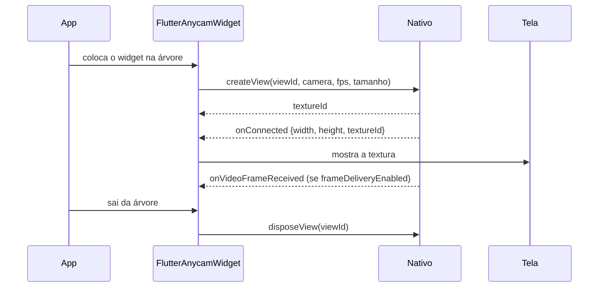
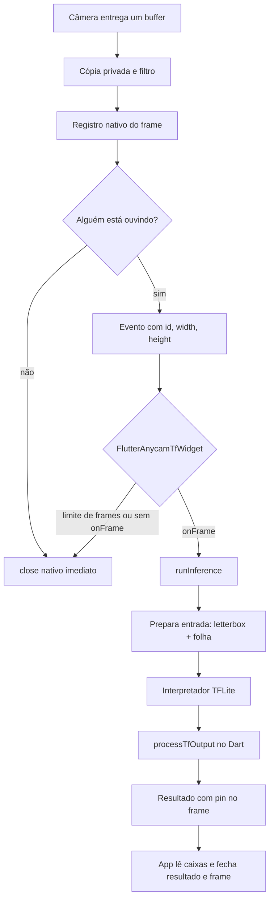

# Guia do Flutter Anycam

Plugin Flutter que abre uma câmera (do celular, USB ou, no Android, um endereço RTSP), mostra a imagem na tela e entrega cada foto para o aplicativo analisar. A análise pesada (TensorFlow Lite e WebRTC) acontece no código nativo. O Dart só recebe um identificador e o resultado.

Este guia começa em linguagem comum e termina na assinatura de cada método público. O WebRTC tem uma página própria: [WEBRTC.md](WEBRTC.md).

---

## 1. A ideia em uma frase

A câmera produz fotos muito rápido. O plugin guarda cada foto na memória nativa, mostra a imagem na tela e avisa o Dart: "chegou a foto número X". Quem recebeu a foto é obrigado a devolvê-la com `close()`. Sem isso, a memória enche e as fotos novas são descartadas.

Há um teto de **12 fotos de câmera vivas** ao mesmo tempo, e **no máximo uma foto viajando** para o Dart por câmera. O preview (a imagem que a pessoa vê) não espera essa fila: ele continua mesmo quando a análise está ocupada.

---

## 2. As peças

| Peça | O que a pessoa vê | O que o código faz |
| --- | --- | --- |
| Câmera | A lente que está aberta | `FlutterAnycamCameraSelector` escolhe traseira, frontal, USB ou RTSP |
| Preview | O retângulo com a imagem ao vivo | Uma textura nativa (`Texture`) dentro de `FlutterAnycamWidget` |
| Frame | Uma foto parada daquele instante | No modo comum, bytes (NV21 no Android, BGRA no iOS). No modo TensorFlow, só `id`, `width` e `height` |
| Modelo | "Tem um rosto aqui" | `FlutterAnycamTfModel.loadModel` + `session.runInference` |
| Resultado | A caixa, a nota e o recorte | `FlutterAnycamTfInferenceResult`, que também precisa de `close()` |
| Evento | A tela muda de estado | `{ viewId, method, data }` no EventChannel |

Dois canais ligam Dart e nativo:

- **MethodChannel** `br.dev.michaellopes.flutter_anycam/channel` — pedidos (abrir, fechar, inferir). Cada pedido recebe **uma** resposta, na thread principal.
- **EventChannel** `br.dev.michaellopes.flutter_anycam/event` — avisos (conectou, frame, falhou). Um erro no canal não cancela os próximos eventos.

---

## 3. Fluxo: ver a câmera



O que a pessoa vê, nessa ordem:

1. **Carregando** — círculo, fundo preto. O widget já pediu a câmera.
2. **Imagem** — `onConnected` trouxe largura, altura e `textureId`, todos maiores que zero.
3. **Falhou** — `createView` lançou erro, devolveu nulo, ou `onConnected` veio sem tamanho. Aparece a mensagem de falha e o botão de tentar de novo.
4. **Sem permissão** — `onUnauthorized`. Em câmera frontal ou traseira o plugin pede a permissão de novo.
5. **Desconectou** — `onDisconnected`. Um sumiço menor que `disconnectDebounce` (2 segundos) não aparece: um USB que pisca não vira tela de erro. Se passar do prazo e `autoRetry` estiver ligado, o widget recria a câmera depois de `autoRetryDelay` (60 segundos).

Trocar de câmera, de fps, de filtro, de tamanho ou de `viewId` **não abre a câmera nova por cima da antiga**. O widget espera o `disposeView` terminar, ignora eventos da câmera que está morrendo e só então cria a próxima. Várias trocas seguidas criam só a última.

Ir para segundo plano no Android pausa e, ao voltar (depois de 200 ms), recria a câmera. No iOS a sessão continua.

---

## 4. Fluxo: analisar um rosto



Contrato de memória, igual no Android e no iOS:

- `close()` do dono é idempotente: chamar duas vezes não quebra.
- Um **pin** segura o frame para quem está lendo ou para um resultado de inferência.
- Um frame interno (o letterbox, e no iOS o frame cru da câmera) só morre quando o último filho fecha.
- Recorte e cópia (`registerTfFrameCrop`, `registerTfFrameCopy`) nascem **sem pai**. Fechar um não fecha o outro.
- No máximo 12 frames de origem vivos. O 13º frame da câmera é descartado.
- A inferência solta o que pegou no `finally`. Cada resultado segura o frame de entrada com um pin até `result.close()`.
- `processTfOutput` espera no máximo **10 segundos**. Se o Dart não responder, a inferência segue sem aquela saída.
- `FlutterAnycamTfSession.dispose()` e `FlutterAnycamTfInferenceResult.close()` são idempotentes e não lançam. `runInference` numa sessão já descartada lança `StateError`: devolver lista vazia deixaria visível o resultado anterior de processadores que guardam a saída numa variável estática.

Duas telas na mesma câmera compartilham **uma** sessão nativa (e portanto um preview). O frame de TensorFlow, que tem um único dono, vai **só para a view mais recente** (a rota que está por cima). Frames comuns, com bytes, continuam indo para todas.

---

## 5. Estados da tela

| Estado | Quando entra | O que aparece | Como sai |
| --- | --- | --- | --- |
| `loading` | Abriu ou está recriando | Indicador de progresso | `onConnected` válido |
| `connected` | `textureId`, largura e altura válidos | A imagem, com `BoxFit.cover` | Falha, desconexão ou troca de câmera |
| `failure` | Erro ao criar, `onFailed`, ou `onConnected` inválido | `texts.failureMessage` e botão | Toque em tentar de novo, ou `autoRetry` |
| `unauthorized` | `onUnauthorized` | `texts.unauthorizedMessage` | Permissão concedida dispara refresh |
| `disconnected` | `onDisconnected` sobreviveu ao debounce | `texts.disconnectedMessage` | Reconexão ou retry |

`autoRetry: false` (o padrão) não recria sozinho. O botão sempre recria, exceto no estado sem permissão de câmera frontal/traseira, em que ele pede a permissão antes.

Um pai sem altura (um `ListView`, uma `Column` sem `Expanded`) não quebra o layout: o widget usa a proporção da própria câmera, ou 4:3 enquanto não conectou.

---

## 6. Cenários

### Abrir e ver

`FlutterAnycamWidget` com a câmera escolhida. Sem `onFrame`, nenhuma foto é entregue ao Dart e o preview segue. Com `onFrame`, cada foto comum chega como `FlutterAnycamFrame` (bytes NV21 ou BGRA).

### Analisar com TensorFlow

`FlutterAnycamTfWidget` com `onFrame`. O widget segura no máximo `maxConcurrentFrames` (padrão 2) análises ao mesmo tempo. O que passar disso é fechado na hora. Se `onFrame` lançar, o frame é fechado e o erro é reportado ao Flutter.

```dart
FlutterAnycamTfWidget(
  camera: camera,
  fps: 5,
  maxConcurrentFrames: 2,
  onFrame: (frame) async {
    final results = await session.runInference(
      inputFrame: frame,
      normalize: FlutterAnycamTfNormalize.none,
    );
    try {
      // usar results
    } finally {
      for (final result in results) {
        await result.close();
      }
      await frame.close();
    }
  },
);
```

Carregue o modelo **uma vez** e compartilhe a `Future`. Duas chamadas paralelas de `loadModel` criam dois interpretadores, e só o último seria descartado.

```dart
final session = await FlutterAnycamTfModel.loadModel(
  assetPath: 'assets/modelo.tflite',
  inputSize: const FlutterAnycamSize(160, 160),
  outputProcessor: meuProcessador,
  delegate: FlutterAnycamTfDelegate.xnnpack,
  threads: 2,
);
```

`outputProcessor` recebe a saída crua e o tamanho de entrada e devolve `List<FlutterAnycamTfInferenceOutput>`. O tracker de caixas escreve `trackingId` nas boxes antes do retorno. A chave do modelo é aleatória por `loadModel`: a sessão nova não derruba a antiga.

### USB que pisca

`onDisconnected` espera `disconnectDebounce`. Se `onConnected` voltar antes, a tela nem troca. Se a câmera sumir de vez, a mensagem aparece e, com `autoRetry: true`, o widget tenta de novo.

### Permissão negada

Câmera frontal e traseira pedem permissão em runtime. USB e RTSP não. Negar deixa o estado `unauthorized`. O botão pede de novo e só recria se a resposta for positiva.

### App em segundo plano

Android: pausar e voltar recria a câmera, para não ficar com uma sessão morta. iOS: não recria.

### Duas telas, uma câmera

A segunda view entra na câmera que já existe e herda fps, filtro, tamanho e modo de quem abriu primeiro. O preview é o mesmo. O frame TensorFlow vai só para a view mais nova. Ao fechar a de cima, a de baixo volta a receber.

### Modelo que não carrega

`loadModel` lança `PlatformException` (ou `StateError` se o nativo responder nulo). Antes, no Android, a mesma falha podia derrubar o processo. Envolva a carga num `try/catch`. Não chame `loadModel` de novo a cada frame: uma falha repetida enche o log e disputa a GPU/CPU.

### Câmera sem preview (infravermelho, segundo sensor)

`FlutterAnycamTfCameraStream.I.register` abre a câmera sem widget. Só Android. Os eventos usam `viewId = -3` e trazem `cameraId`, então dois streams não misturam os frames. Sem `onFrame`, o frame é fechado. `register` devolve um disposer; chame-o ao sair. Se a mesma câmera já está num widget, o registro nativo recusa. O inverso também: `createView` falha com erro se um stream sem preview já é dono daquela câmera.

### Enviar vídeo para outra pessoa

Só Android, e só câmera frontal ou traseira. A ordem que evita tela preta no outro lado: `newStream` → esperar `onConnectedCallback` (ICE conectado) → `FlutterAnycamWebRtcCameraFeed.I.attach`. O feed manda o quadro direto da câmera para todos os peers conectados; `attach` não recebe `streamId`. Detalhe, sinalização e a tabela de problemas em [WEBRTC.md](WEBRTC.md). No iOS esses métodos não quebram o app: `attach` devolve um disposer vazio, e o resto responde `false` ou `PlatformException('unsupported')`.

### iPhone sem duas câmeras ao mesmo tempo

Aparelhos sem multi-câmera (anteriores ao suporte de `AVCaptureMultiCamSession`) têm uma sessão só. Abrir a segunda câmera pausa a primeira sem evento de erro, para um retry automático não roubar o hardware de volta. Quando a nova fecha, a anterior reabre sozinha. Se as duas juntas passarem do custo de hardware da sessão, a que está abrindo recebe `onFailed` em vez de derrubar as duas.

### Sessão de captura que morre no iOS

Um `AVCaptureSessionRuntimeError` vira `onFailed`, com a mensagem do sistema. Se o serviço de mídia reiniciou, a sessão tenta `startRunning` de novo.

---

## 7. Android e iOS

| Assunto | Android | iOS |
| --- | --- | --- |
| Câmera traseira e frontal | CameraX, com Camera2 quando precisa | AVFoundation, uma sessão compartilhada |
| USB | Sim | Não |
| RTSP | A classe ainda existe. O changelog 1.1.13 marca o suporte como descontinuado por causa da página de 16 KB da Play Store | Não |
| Frame comum | NV21. Depois de redimensionar, `rowStride == width` e `pixelStride == 1` | BGRA8888, com `bytesPerRow` |
| Frame TensorFlow | Só `id`, `width`, `height` | Igual: os pixels ficam nativos. `getJpeg()` busca os bytes |
| Delegado TFLite | `cpu`, `gpu`, `nnapi`, `xnnpack` | XNNPack, com volta para CPU. Não use GPU aqui |
| WebRTC e stream sem preview | Sim | Métodos exclusivos de Android: `false`, `true` ou erro `unsupported` |
| Zoom | Traseira, frontal e USB. Mínimo 1 | Traseira e frontal, limitado ao máximo do formato |
| Exposição | Traseira e frontal | Traseira e frontal, em EV, limitado ao que o aparelho aceita |
| Flash | Traseira | Traseira |
| Vários engines Flutter | O evento de cada view volta para o engine que deu `createView` | Um engine |
| Fila de trabalho | Executor de 3 threads. A resposta volta à main thread | `workQueue` concorrente. A resposta volta à main thread |

`FlutterAnycam.setZoom` e `setExposureCompensation` ignoram o pedido quando a câmera não suporta (USB não tem exposição; RTSP não tem nenhum dos dois).

---

## 8. Referência de API

Tudo abaixo é público em `package:flutter_anycam/flutter_anycam.dart`, salvo indicação de canal.

### Câmera e controles

```dart
static Future<List<FlutterAnycamCameraSelector>> FlutterAnycam.availableCameras()
static Future<void> FlutterAnycam.enableFlash()
static Future<void> FlutterAnycam.disableFlash()
static Future<void> FlutterAnycam.setZoom({
  required FlutterAnycamCameraSelector camera,
  double zoom = 1.0,
})
static Future<void> FlutterAnycam.setExposureCompensation({
  required FlutterAnycamCameraSelector camera,
  int value = 0,
})
```

```dart
FlutterAnycamCameraSelector({
  required String id,
  required String name,
  required FlutterAnycamLensFacing lensFacing, // back, front, usb, rtsp, unknown
  required int sensorOrientation,
  FlutterAnycamCameraType cameraType = FlutterAnycamCameraType.unknown,
  Map<String, dynamic>? extras,
  int minExposureValue = 0,
  int maxExposureValue = 0,
})
```

`lensFacing` vem de `availableCameras()`. Não invente um `id`. `previewRotation` devolve `sensorOrientation` quando a orientação foi forçada, senão 0.

### Widget de preview

```dart
const FlutterAnycamWidget({
  required FlutterAnycamCameraSelector camera,
  FlutterAnycamStreamFrameCallback? onFrame,          // (FlutterAnycamFrame) → void
  FlutterAnycamStreamMethod? onRawVideoFrameReceived, // mapa cru; tem prioridade sobre onFrame
  FlutterAnycamTexts texts = const FlutterAnycamTexts(),
  int? viewId,                    // padrão: hashCode do estado
  int fps = 5,
  double? aspectRatio,
  double previewScale = 1,
  FlutterAnycamSize preferredSize = const FlutterAnycamSize(640, 480),
  FlutterAnycamSize? resizeFrame,
  FlutterAnycamFilter filter = FlutterAnycamFilter.none,
  FlutterAnycamType type = FlutterAnycamType.standard, // standard | tf
  int? previewRotation,
  bool previewEnabled = true,
  bool frameDeliveryEnabled = true,
  bool autoRetry = false,
  Duration autoRetryDelay = const Duration(seconds: 60),
  Duration disconnectDebounce = const Duration(seconds: 2),
  bool enableDebug = false,
})
```

`FlutterAnycamWidgetState.getSceneData()` devolve a escala entre a caixa Flutter e o preview nativo: `scaleX`, `scaleY`, `flutterPreviewSize`, `nativePreviewSize`. Serve para desenhar uma caixa de rosto por cima da imagem.

Filtros: `none` (0), `grayscale` (1), `grayscaleLowContrast` (2), `grayscaleMediumContrast` (3), `grayscaleHighContrast` (4). O filtro é aplicado numa cópia. O preview não é alterado.

```dart
Future<Uint8List?> FlutterAnycam.frameConversor.convertToJpeg({
  required FlutterAnycamFrame frame,
  FlutterAnycamFilter filter = FlutterAnycamFilter.none,
  FlutterAnycamCrop? crop,
  int quality = 100,
})
```

No Android a qualidade é limitada a 1–100. Um buffer NV21 menor que `width * height * 3 / 2` é recusado.

### Widget TensorFlow

```dart
const FlutterAnycamTfWidget({
  required FlutterAnycamCameraSelector camera,
  FlutterAnycamStreamTfFrameCallback? onFrame, // (FlutterAnycamTfFrame) → Future
  FlutterAnycamSize preferredSize = const FlutterAnycamSize(640, 480),
  FlutterAnycamSize? resizeFrame,
  FlutterAnycamFilter filter = FlutterAnycamFilter.none,
  int? viewId,
  int fps = 5,
  int maxConcurrentFrames = 2,
  double? aspectRatio,
  double previewScale = 0,
  int? previewRotation,
  bool autoRetry = false,
  bool enableDebug = false,
  FlutterAnycamTexts texts = const FlutterAnycamTexts(),
})
```

Por baixo é um `FlutterAnycamWidget` com `type: tf`. Sem `onFrame`, ou acima do limite, o frame é fechado.

### Modelo, sessão e resultado

```dart
static Future<FlutterAnycamTfSession> FlutterAnycamTfModel.loadModel({
  required String assetPath,
  required FlutterAnycamSize inputSize,
  required TfOutputProcessor outputProcessor,
  FlutterAnycamTfTrackerOptions? trackerOptions,
  FlutterAnycamTfDelegate delegate = FlutterAnycamTfDelegate.nnapi,
  int threads = 1,
})

typedef TfOutputProcessor = List<FlutterAnycamTfInferenceOutput> Function(
  dynamic data,
  FlutterAnycamSize inputSize,
);
```

Delegados: `cpu`, `gpu`, `nnapi`, `xnnpack`. No iOS, qualquer coisa diferente de `cpu`/`none` tenta XNNPack e cai para CPU.

```dart
Future<List<FlutterAnycamTfInferenceResult>> session.runInference({
  required FlutterAnycamTfFrame inputFrame,
  FlutterAnycamFilter filter = FlutterAnycamFilter.none,
  FlutterAnycamTfNormalize normalize = FlutterAnycamTfNormalize.none,
})
Future<void> session.dispose() // idempotente, não lança
bool session.isDisposed
```

Normalização, valor enviado ao nativo entre parênteses: `centered`, `custom`, `imageNet` (`imagenet`), `simple`, `bgr`, `none`.

```dart
FlutterAnycamTfTrackerOptions({
  double threshold = 0.3,
  int maxMissed = 5,
  int minHits = 3,
  MatchFn? matchFn, // padrão: MatchStrategy.iou
})
```

O tracker usado pela sessão marca `trackingId` na box. `FlutterAnycamTfBBoxTracker` também pode ser usado sozinho: `update(boxes)` escreve o id em cada box, `count`, `currentFrame`, `reset()`. O id sobrevive a alguns frames vazios (`maxMissed`) e a uma lista que chega em outra ordem.

```dart
Future<FlutterAnycamTfFrame?> result.getFrame()
Future<FlutterAnycamTfFrame?> result.getRawFrame()
Future<FlutterAnycamTfFrame?> result.getCroppedFrame()
Future<FlutterAnycamTfFrame?> result.getScaledCroppedFrame()
Future<bool> result.close() // idempotente
```

Cada getter busca uma vez e guarda. `getRawFrame` pula o letterbox. Fechar o resultado fecha os frames derivados e solta o pin do frame principal. Não use um resultado depois do `close()`.

```dart
FlutterAnycamTfInferenceOutput({
  FlutterAnycamTfInferenceOutputBox? box,
  FlutterAnycamTfInferenceOutputKeypoint? keypoint,
  List<double>? embedding,
  List<List<double>>? segmentation,
  String? text,
  required double score,
})
```

`fromMap` aceita o que o canal entrega: `Float32List`, `Float64List` ou `List` de `num`. A box usa `xMin`, `yMin`, `xMax`, `yMax` (inteiros; double é truncado), `srcWidth`, `srcHeight`, `classId` (padrão -1), `trackingId`, `cropPadPercent`, `minScaledCropSize`.

### Frame TensorFlow

```dart
FlutterAnycamTfFrame(String id, int width, int height, {int? rawWidth, int? rawHeight})
factory FlutterAnycamTfFrame.fromMap(Map<String, dynamic> map)
static Future<FlutterAnycamTfFrame?> fromJpeg(Uint8List jpegBytes)

Future<void> frame.close()          // idempotente, não lança
Future<Uint8List?> frame.getJpeg()  // null se já fechou
Future<double?> frame.getBlurScore({FlutterAnycamTfBlurRoi? roi, int sampleStep = 2})
Future<FlutterAnycamTfIlluminationScore?> frame.getIlluminationScore({
  FlutterAnycamTfBlurRoi? roi,
  int sampleStep = 2,
})
```

O blur é a variância do Laplaciano: maior significa mais nítido. A iluminação traz a luminância média de 0 a 255. A região (`roi`) é normalizada de 0 a 1. Valor infinito é recusado, não derruba o app.

Cópias, pelo canal (quem chama fica dono e precisa fechar):

```dart
Future<Map<String, dynamic>?> registerTfFrameCopy({required String frameId})
Future<Map<String, dynamic>?> registerTfFrameCrop({
  required String frameId,
  required int x,
  required int y,
  required int width,
  required int height,
  FlutterAnycamSize? resizeTo,
})
Future<bool> closeTfFrame({required String frameId})
```

### Stream sem widget e stream cru

```dart
Future<FlutterAnycamTfCameraStreamDisposer> FlutterAnycamTfCameraStream.I.register({
  required FlutterAnycamCameraSelector camera,
  int fps = 5,
  FlutterAnycamSize preferredSize = const FlutterAnycamSize(640, 480),
  FlutterAnycamFilter filter = FlutterAnycamFilter.none,
  void Function(FlutterAnycamTfFrame frame)? onFrame,
  void Function({required String cameraId, required int width, required int height})? onConnected,
  void Function({required String cameraId, required String message})? onFailed,
})
```

```dart
Future<FlutterAnycamCameraRawStreamDisposer> FlutterAnycamCameraRawStream.I.register({
  required String cameraId,
  required int fps,
  required void Function(FlutterAnycamFrame frame) listener,
})
```

O stream cru é Android e publica em `viewId = -2` (`onCameraRawFrame`). `currentCameraId` é o id que o feed WebRTC consulta.

### WebRTC (Android)

```dart
Future<FlutterAnycamWebRtcStream?> FlutterAnycamWebRtc.I.newStream({
  FlutterAnycamWebRtcCallbacks? callbacks,
  List<FlutterAnycamWebRtcIceServer>? iceServers,
})
Future<bool?> FlutterAnycamWebRtc.I.pushFrame(
  FlutterAnycamWebRtcI420Image image, {
  String? streamId,
})

Future<void> stream.dispose()
Future<Map<String, dynamic>> stream.createAnswer(
  String offerSdp, {
  List<FlutterAnycamWebRtcIceServer>? iceServers,
})
Future<bool?> stream.addCandidate(Map<String, dynamic> data)
Future<bool?> stream.sendDataMessage(Map<String, dynamic> data)

Future<FlutterAnycamWebRtcCameraFeedDisposer> FlutterAnycamWebRtcCameraFeed.I.attach({
  required String cameraId,
  required int fps,
  bool alsoDeliverToFlutter = false,
  FlutterAnycamSize? streamSize,
})
Future<void> FlutterAnycamWebRtcCameraFeed.I.detach({required String cameraId})
```

```dart
FlutterAnycamWebRtcCallbacks({
  void Function()? onConnectedCallback,
  void Function()? onDisconnectedCallback,
  void Function(Map<String, dynamic> data)? onCandidateCallback,
  void Function(Map<String, dynamic>? data)? onDataMessageCallback,
})
FlutterAnycamWebRtcIceServer({
  required String hostname,
  String? username,
  String? password,
})
```

`createAnswer` completa com o SDP ou com `PlatformException`. Um ICE com `hostname` vazio é ignorado; se a lista inteira for inválida, entram os STUN públicos do Google.

### Eventos

O nativo envia:

```dart
{ "viewId": int, "method": String, "data": Map }
```

| `method` | Quem escuta | `data` |
| --- | --- | --- |
| `onConnected` | Widget da view | `width`, `height`, `textureId` |
| `onDisconnected` | Widget | vazio |
| `onUnauthorized` | Widget | vazio |
| `onFailed` | Widget | `message` |
| `onVideoFrameReceived` | Widget | frame comum (bytes) ou TF (`id`, `width`, `height`) |
| `onCameraRawFrame` | Stream cru, view `-2` | frame NV21 |
| `onTfCameraStreamConnected` | Stream TF, view `-3` | `cameraId`, `width`, `height` |
| `onTfCameraStreamFrame` | Stream TF, view `-3` | `cameraId` + frame TF |
| `onTfCameraStreamFailed` | Stream TF, view `-3` | `cameraId`, `message` |

Um listener com `viewId: -1` recebe todos. Um listener que lança não impede os outros. Um frame TF cujo evento ninguém tratou é fechado pelo próprio canal Dart.

O nativo também chama o Dart, pelo MethodChannel, no meio da inferência:

```dart
processTfOutput({ "modelKey": String, "output": dynamic }) → List
```

O processador da sessão daquela chave responde. Sem ouvinte, a resposta é `[]`. Se duas sessões usarem a mesma chave, vale a última; descartar a antiga não remove a nova.

---

## 9. Quando a tela fica preta ou parada

| O que você vê | Causa provável | O que verificar |
| --- | --- | --- |
| Círculo eterno | `onConnected` não chegou, ou chegou sem `textureId` e tamanho | Log `createView failed` / `invalid onConnected`. No Android, a câmera pode estar presa num stream TF sem preview |
| Preto com a tela "conectada" | Textura sem frames, sessão parada, ou `previewEnabled: false` | iOS: `onFailed` de runtime ou de custo de hardware. USB: debounce ainda não venceu |
| Preview congela e a análise segue | A fila de entrega está ocupada | Esperado enquanto `onFrame` não devolve. O preview em si não deveria parar; se parar no iOS, o processamento pesado voltou para a fila da câmera |
| Análise para de ver gente | 12 frames vivos | Alguém recebeu um frame e não chamou `close()`, ou um resultado ficou aberto |
| Caixa de rosto no lugar errado | Escala da tela diferente do frame | Use `getSceneData()` e o `srcWidth`/`srcHeight` da box, não o tamanho do widget |
| `MissingPluginException` no iOS | Método só de Android chamado numa versão antiga | Nesta versão a resposta é `false` ou `PlatformException('unsupported')` |
| Future que nunca completa | Resposta nativa que não voltou | Os caminhos de `createWebRtcAnswer` respondem também quando o start falha ou a fila de sinalização já fechou |

---

## 10. Permissões

Android, no manifesto: `CAMERA`, `USB_PERMISSION`, `android.hardware.usb.host`, e o `intent-filter` `USB_DEVICE_ATTACHED` na activity. Microfone só se for usar o áudio do WebRTC.

iOS, no `Info.plist`: `NSCameraUsageDescription`. `NSMicrophoneUsageDescription` se for capturar áudio.

O pedido em runtime é `requestPermission` / `broadcastPermissionGranted`, disparado pelo widget no estado `unauthorized`.
